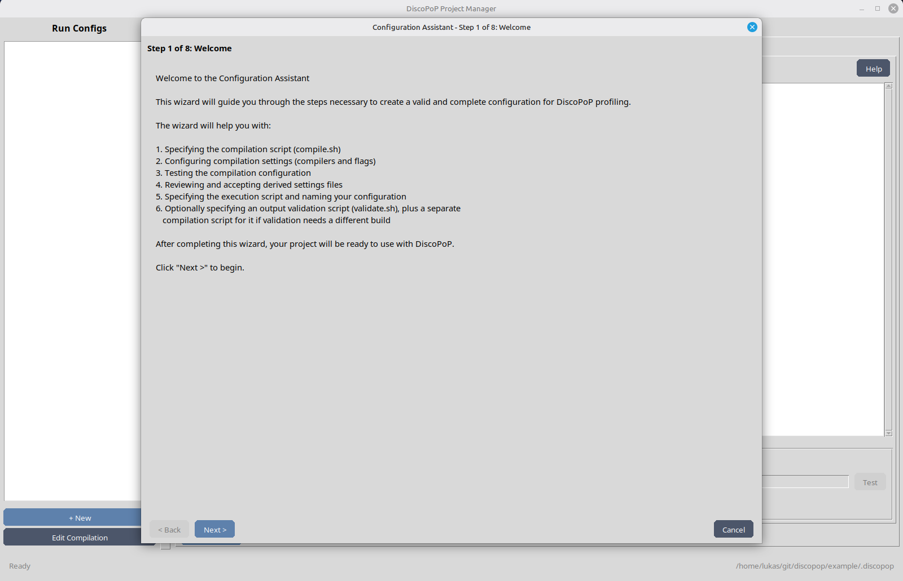
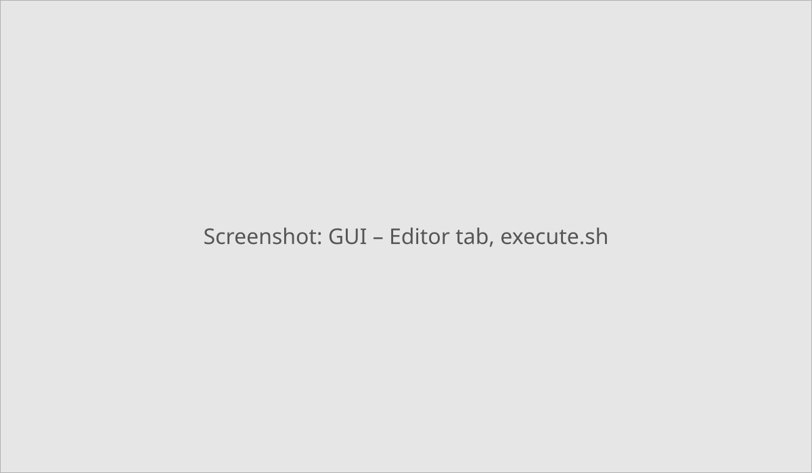
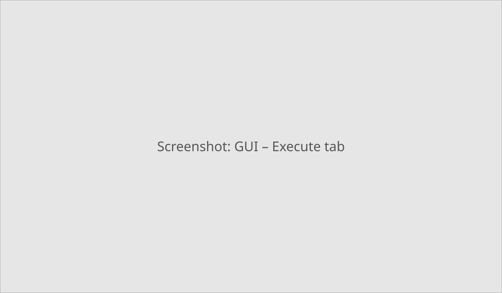
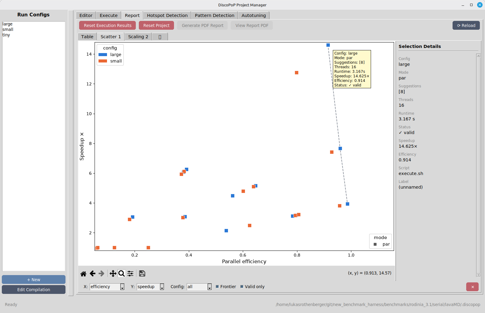
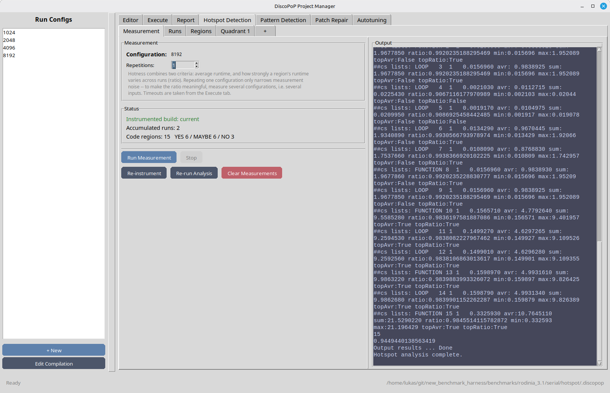
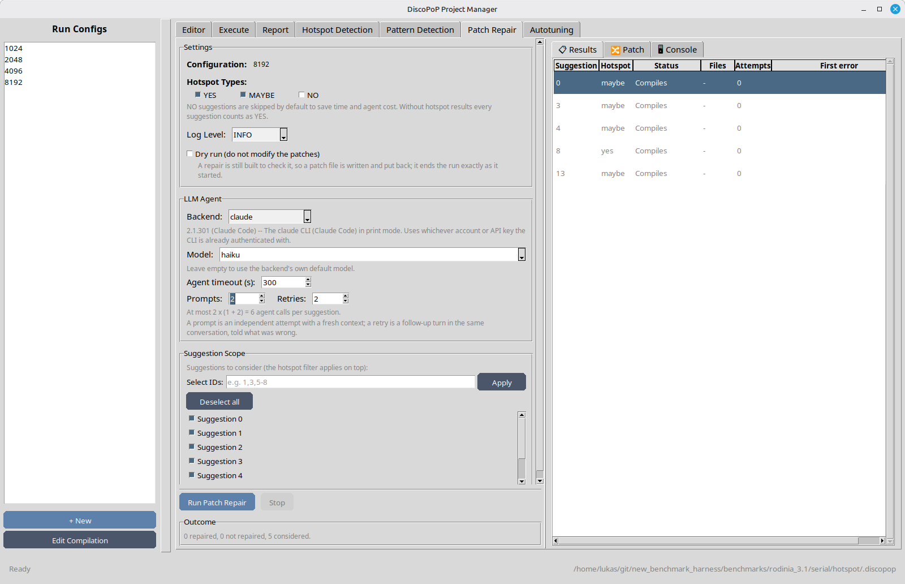

# GUI walk-through
This walk-through takes the example program from a first configuration to an autotuned, parallelized version with the graphical user interface `discopop_gui`. Each tab runs the matching DiscoPoP tool for you; the same steps on the command line are shown in [Project manager on the command line](project_manager_cli.md).

The labels below are taken from the source code of the GUI (`library/discopop_library/ProjectManager/gui`).

{: .note }
The screenshots are placeholders; they will be replaced by real ones.

## Prerequisites
- DiscoPoP is [installed](../setup/discopop.md), the virtual environment is active, and `python3-tk` and a display are available.
- Work on a copy of the example: `cp -r example /tmp/dp_example`.

## Step 1: Start the GUI
Start the GUI in the project directory, or select the project with `-p`:

```bash
cd /tmp/dp_example
discopop_gui
```

`discopop_project_manager --gui` does the same. If the project has no `.discopop/project/configs` folder yet, the GUI creates it and shows a message, "Project Initialized". The window "DiscoPoP Project Manager" opens.


The left column "Run Configs" lists the configurations of the project and has the buttons "+ New" and "Edit Compilation". The right side has the tabs Editor, Execute, Report, Hotspot Detection, Pattern Detection, Patch Repair and Autotuning. The bottom bar shows the status and the path of the `.discopop` folder.

## Step 2: Create a configuration with the wizard
If the project has no real configuration yet, the "Configuration Assistant" opens on its own. Its steps are:

1. **Welcome**: an overview of the steps.
2. **Write Permissions Check**: tells whether DiscoPoP can copy the project into its parent folder. Without write access, executions are limited to the "in-place" mode.
3. **Compilation Script**: edit `compile.sh`. It is executed from the project root and has to use `$CC`/`$CXX` and `$CFLAGS`/`$CXXFLAGS`. For the example, replace the placeholder with `$CXX $CXXFLAGS example.cpp -o prog`.
4. **Compilation Settings**: the fields "C Compiler (CC)", "C++ Compiler (CXX)", "C Flags (CFLAGS)" and "C++ Flags (CXXFLAGS)". The defaults are `clang` and `clang++`.
5. **Test Compilation**: click "Run Test Compilation"; the status shows "Success" or "Failed" and the output appears below.
6. **Derived Settings**: review the settings DiscoPoP derives for the other modes, in the sub-tabs `dp_settings.json`, `hd_settings.json` and `par_settings.json`.
7. **Execution Script**: enter a "Configuration Name" (default `default`) and the `execute.sh`. For the example: `./prog`.
8. **Validation Script**: optional `validate.sh` (checks the program output; a run counts as correct only if `execute.sh` and `validate.sh` both succeed) and `compile_validate.sh` (only if validation needs another build). Leave both empty for the example.

"Next >" moves on, "< Back" goes back, "Cancel" asks for confirmation, "Finish" creates the configuration and opens the Execute tab.

<!-- TODO screenshot: replace placeholder -->


You can open the wizard's results again later: "Edit Compilation" in the left column opens an editor for `compile.sh` and the settings files, with the buttons "Save (Ctrl+S)", "Test Compilation" and "Derive" (derives the settings of the other modes from `seq_settings.json`). "+ New" adds a further configuration; a right click on a configuration offers Copy, Rename and Delete.

## Step 3: Edit the scripts
The tab **Editor** shows the files of the selected configuration in the sub-tabs `execute.sh`, `compile.sh (override)`, `validate.sh` and `compile_validate.sh (override)`. "Help" explains each script; "Add Override" and "Add validate.sh" create the optional ones. Save with "Save (Ctrl+S)".

<!-- TODO screenshot: replace placeholder -->


The box **Execution time** below `execute.sh` sets what is measured. Off (default), the wall clock time of `execute.sh` is used. If your program prints its own time, tick "Read the execution time from the program's console output" and enter a regular expression whose first capture group holds the value, e.g. `Total time:\s*([0-9.]+)`. "Test" matches the pattern against the output of the last recorded run and shows "Matched in the last recorded run: ... s" or a failure. The setting is stored per configuration; see [Project manager](../tools/Project_manager.md).

The example prints no time, so keep the default.

## Step 4: Execute
Open the tab **Execute**.

<!-- TODO screenshot: replace placeholder -->


| Group | Settings |
|---|---|
| Execution Modes | "Sequential (seq)", "DiscoPoP Instrumented (dp)", "Hotspot Detection (hd)", "Parallel (par)". A mode is selectable once its settings file, the compile script and `execute.sh` exist. |
| Execution Settings | "Thread Count", "Repetitions" (the median is reported; only seq and par are repeated), "Label Prefix" |
| Timeout Settings | "Execution (s)", "Compilation (s)", "Validation (s)"; 3600 by default, 0 disables |
| Logging & Behavior | "Log Level"; "Execute in-place (skip project copy)"; "Skip cleanup (keep project copies)" |
| Apply Suggestions | "None", "Apply manually selected suggestions" (select ids, "Browse / Edit →" opens the patches), "Apply autotuner-selected suggestions" |

Select `seq`, `dp`, `hd` and `par` and click "Run". The "Output" panel shows the compilations and runs; "Stop" cancels. The button "Prepare Pattern Detection" compiles and runs the configuration in `dp` mode in place, which creates the profiling data that the Pattern Detection tab needs.

For the example, click "Prepare Pattern Detection" now. Runs of the `dp` mode in a project copy delete their profiling data with the copy.

## Step 5: Report
The tab **Report** shows all stored measurements.

<!-- TODO screenshot: replace placeholder -->


- The tab "Table" lists Config, Script, Setting, Label, Applied Suggestions, Not Applied, Threads, Status, Time, Speedup and Efficiency.
- The "+" tab adds charts: "Trade-off scatter", "Thread scaling", "Speedup / efficiency bars" and "Runtime bars". Click a point or bar to see its details in the bar at the side.
- "Generate PDF Report" and "View Report PDF" create and open `full_report.pdf` (written to `.discopop/project/reports/<timestamp>/`); "⟳ Reload" refreshes the view.
- "Reset Execution Results" deletes the measurements and reports; "Reset Project" deletes everything in `.discopop` except the configuration files. Both ask for confirmation.

## Step 6: Hotspot detection (optional)
The tab **Hotspot Detection** measures which code regions take the most time. Pattern detection and the hotspot-guided autotuning use the result.

<!-- TODO screenshot: replace placeholder -->


On the sub-tab "Measurement", set "Repetitions" and click "Run Measurement". It instruments the configuration in `hd` mode (if the build is not current), runs it and records a run; the "Status" box shows the build state, the accumulated runs and the number of code regions classified YES / MAYBE / NO. "Re-instrument" rebuilds, "Re-run Analysis" analyzes the recorded runs again, "Clear Measurements" deletes them.

The hotness of a region combines its average runtime with how strongly the runtime varies between runs. With a single run every ratio is 0.5, so measure a second configuration with another input size and click "Run Measurement" again for a meaningful result. The sub-tabs "Runs" and "Regions" list the recorded runs and the regions (Hotness, Kind, Location, Name, Avg, Share, Min, Max, Ratio, Runs). The "+" tab adds the charts "Hotness quadrant", "Top-N runtime bars" and "Per-region run profile". "Show in VSCode" in the detail bar opens a region in VS Code, if the `code` command is available.

For the example, which has a single configuration and runs only a few milliseconds, you can skip this step.

## Step 7: Pattern detection
Open the tab **Pattern Detection**. It is enabled after profiling data exists in `.discopop/profiler`. Without hotspot results, a box "Hotspot Information" suggests to run the hotspot detection first ("Go to Hotspot Detection").


- **Pattern Types**: `reduction` and `doall` are selected, `task` (experimental) is not.
- **Dependency Data**: "default (full states)" or "no_states (states ignored)".
- **Threads**: `auto` or a number.
- "Show graph visualization" runs the explorer inside the GUI, which is unresponsive meanwhile, and shows the graphs on the sub-tab "Graph Visualization".

Click "Run Pattern Detection". The output of the [explorer](../tools/Explorer.md) appears in the "Output" panel; afterwards "Browse Suggestions" is enabled (or the message "No patterns found."). It opens the window "Browse Parallelization Suggestions": a list "Suggestions (n)" on the left, which expands to the patch files of each suggestion, and the patch with highlighted changes on the right. For the example you see suggestion 0 (`#pragma omp parallel for firstprivate(N)`) and 1 (`... reduction(+:sum)`). You can edit a patch and save it with "Save File". "Show Suggestions in VSCode" opens the project in VS Code for the [extension](walk_through_vscode.md).

To select suggestions, use the selectors that appear in the Execute and Autotuning tabs: they list the ids, with "Select all"/"Deselect all" and an entry "Select IDs" that takes lists and ranges such as `1,3,5-8`.

## Step 8: Patch repair (optional)
Some patches do not compile in a real project. The tab **Patch Repair** asks a large language model to fix them; see [Patch repair](../tools/Patch_repair.md). It is not needed for the example.

<!-- TODO screenshot: replace placeholder -->


Choose the "Hotspot Types" to consider (YES, MAYBE, NO; NO is off by default), the "LLM Agent" ("Backend", "Model", "Agent timeout (s)", "Prompts", "Retries"), tick "Dry run (do not modify the patches)" to leave the patches as they are, restrict the "Suggestion Scope" and click "Run Patch Repair". The result appears in the sub-tabs "Results" (one row per suggestion: Repaired, Compiles, Not repaired, Patch not applicable, ...), "Patch" (original and repaired patch side by side) and "Console". The box "Outcome" summarizes the run.

## Step 9: Autotuning
The tab **Autotuning** measures which suggestions, or which combination of them, really speed the program up.


- "Threads", "Repetitions" (runs per candidate; the median decides) and "Log Level".
- "Hotspot Types" (YES by default) and the "Algorithm": "No combination (measure only)", "Linear combination", "Evolutionary combination", "Greedy combination", "Coordinate descent combination" and "Hotspot-guided region descent" (default; needs hotspot results, a red hint tells when they are missing).
- "Suggestion Selection": "Search for best combination" (with the suggestions the algorithm may explore) or "Evaluate a specific combination" (apply the chosen ids together and compare them to the baseline).

For the example, choose "No combination (measure only)", which measures each suggestion alone, and click "Run Autotuning". The "Live Plot" shows the candidates as they are measured, the "Console" shows the output of `discopop_auto_tuner`, and "Selected Suggestion IDs" lists the winner. The status bar reports "Autotuning completed successfully". The example runs for milliseconds, so expect a speedup below 1; use a realistic workload for a real result.

To apply the result, go to the Execute tab, select "Apply autotuner-selected suggestions" and run the `par` mode: the suggestions are applied in the project copy that is executed. The Report tab then shows the speedup. To change your sources permanently, use the [patch applicator](../tools/Patch_applicator.md).

## Where to go next
- [GUI](../tools/GUI.md) describes each tab in detail.
- [Project manager](../tools/Project_manager.md) and [Autotuner](../tools/Autotuner.md) explain the underlying tools.
