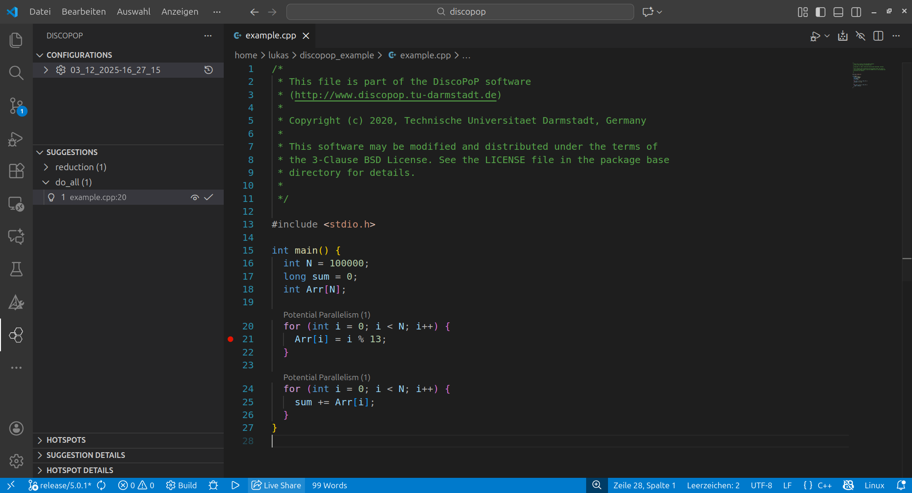
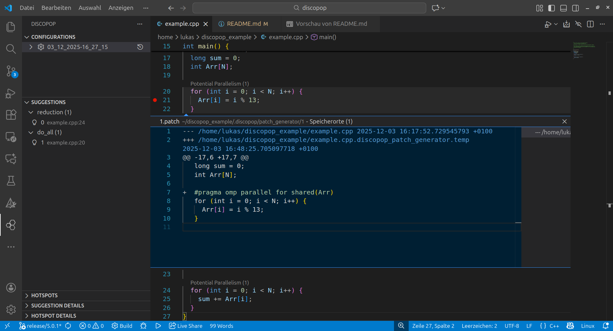

# VS Code extension walk-through
The DiscoPoP VS Code extension is an optional addition to the [GUI](walk_through_gui.md) and the command line tools. It does not replace them; use it to browse, preview and apply the suggestions (and hotspots) that an analysis has already written to a `.discopop` folder. This walk-through shows the steps for the example program of the repository.

## Prerequisites
- Follow the [setup of the VS Code extension](../setup/vscx.md).
- Analyze the example first, with the GUI ([GUI walk-through](walk_through_gui.md)) or on the command line ([Command line walk-through](walk_through.md)):

```bash
cp -r example /tmp/dp_example && cd /tmp/dp_example
discopop_cxx example.cpp -o example
./example
cd .discopop && discopop_explorer
```

## Step 1: Open the project in VS Code
Open the project folder (the folder that contains `.discopop`) in VS Code, or click "Show Suggestions in VSCode" in the Pattern Detection tab of the GUI. Open the DiscoPoP view; by default it is in the sidebar.

## Step 2: Create a configuration
If the `.discopop` folder was created newly, the extension adds a configuration automatically. By default, the current timestamp is the label of the configuration (in the screenshots below, `03_12_2025-16_27_15`) and it is shown in the `Configurations` view.

To add a configuration manually, hover over `CONFIGURATIONS`, click `+` and select `ViewOnly`. Choose a name and the path to the `.discopop` folder. The configuration types `ViewOnly` and `Script` show the results of an analysis that was started elsewhere; a `Script` configuration can additionally start a script that writes a `.discopop` folder.

## Step 3: Load and browse the results
Click the clock-like `Load Results` button next to the configuration name. The identified suggestions appear in the `Suggestions` view. Click a suggestion to see its details in `SUGGESTION DETAILS` and the relevant code in the editor.



The following screenshot shows an exemplary suggestion preview.



## Step 4: Apply suggestions
Hover over a suggestion and click the icon that appears to apply it, or to roll back its application. In the source code, the annotations `Potential Parallelism(count)` mark the code regions with suggestions. Clicking an annotation applies the suggestion; if several suggestions exist for the region, you are asked which one to apply.

## Further usage
- Open `.discopop` in a terminal to use the tools on the command line, e.g. [patch applicator](../tools/Patch_applicator.md), or to look at the generated patches.
- Hotspot detection results can be viewed like suggestions if they are stored in the `.discopop` folder of the configuration.

<!-- UNVERIFIED: the behavior of the extension itself (configuration types, buttons, annotations) is taken from the previous documentation; it was not re-checked against the extension. -->
