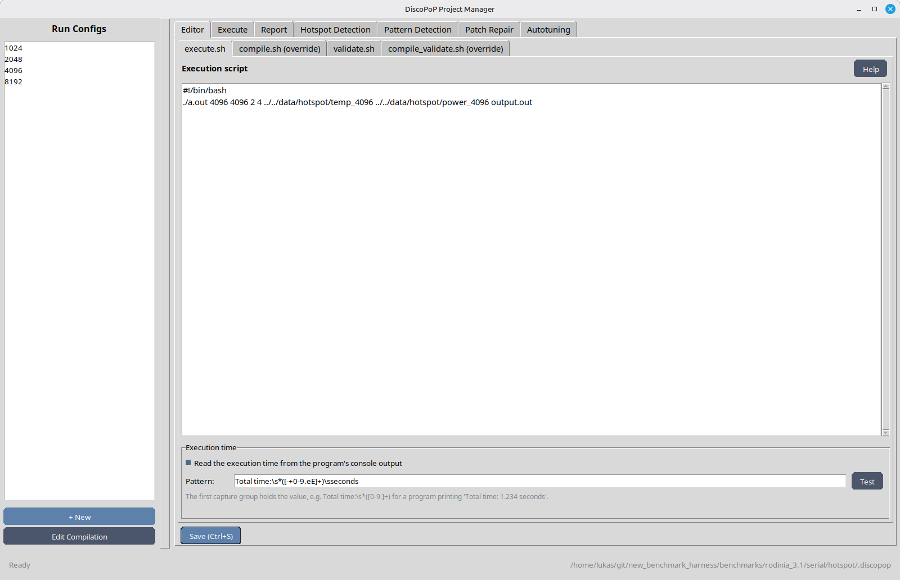
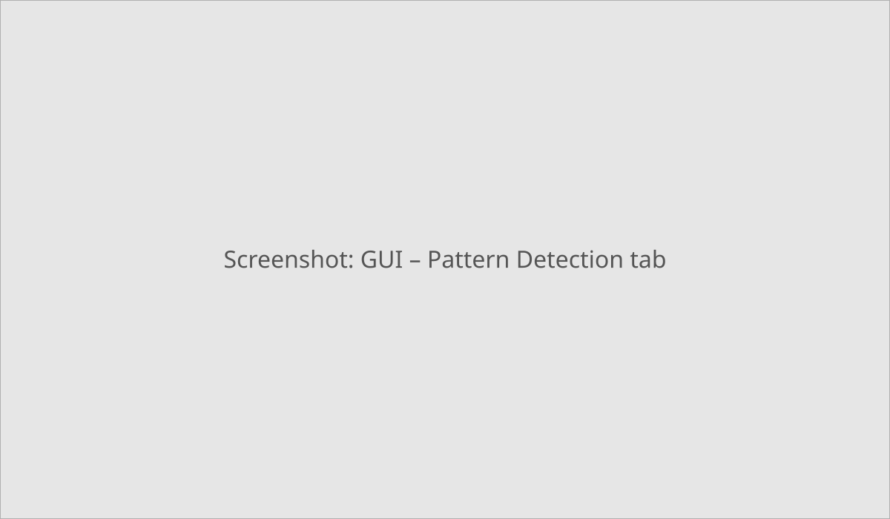
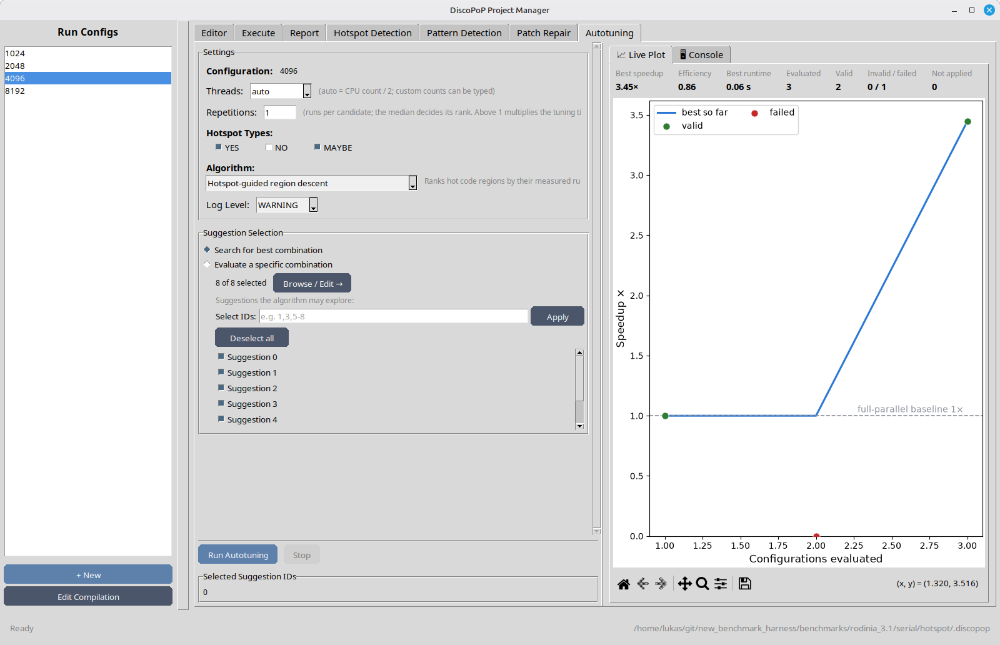

# Getting started
This page takes you from the installation to the first parallelization suggestions and a measured speedup, using the graphical user interface (GUI). The [GUI walk-through](examples/walk_through_gui.md) goes through the same steps on an example program and explains them in more detail, and the [Manual](manual.md) describes every tool and option.

## Prerequisites
* A Linux system with Python 3.11 or newer and a display (the GUI uses Tk).
* The system packages below. The profiler is built from source during the installation.
* A C or C++ project that builds with the compilers and flags given in the environment variables `$CC`/`$CXX` and `$CFLAGS`/`$CXXFLAGS`. DiscoPoP sets these variables to instrument your code, so a build script that hard-codes `gcc` does not work.
* A small, representative input. The instrumented program runs much slower than the original one, and DiscoPoP only sees the code paths that are executed.

```bash
sudo apt install python3 python3-pip python3-venv python3-tk build-essential cmake git llvm-19-dev clang-19 clang-tools-19 libomp-19-dev libboost-dev
```
LLVM 19 to 22 are supported. For other distributions and versions, see [Installation](setup/discopop.md).

## Install
```bash
python3 -m venv venv
source venv/bin/activate
pip install discopop
```
This installs all DiscoPoP packages, including the GUI. It takes a few minutes, as the profiler is compiled. To install from a checkout of the repository instead, see [Installation](setup/discopop.md).

## Start the GUI
With the virtual environment activated, go to your project and start the GUI:
```bash
cd <your project>
discopop_gui
```
Use `discopop_gui -p <project directory>` to start it from another directory. DiscoPoP keeps all its data in the folder `.discopop` of the project.



## Configure the project
On the first start, the Configuration Assistant asks for two scripts and checks that they work:

* the **compilation script** `compile.sh`, which builds your project from its root directory, for example
  ```bash
  #!/bin/bash
  $CXX $CXXFLAGS main.cpp -o prog
  ```
* the **execution script** `execute.sh` of a configuration (a named input, e.g. `tiny`), which runs the program, for example
  ```bash
  #!/bin/bash
  ./prog input_small.txt
  ```

Optionally, a validation script `validate.sh` checks that the output is still correct after a parallelization. The assistant derives the settings for the instrumented and the parallel builds itself; you can review them later in the *Editor* tab.

## Find and measure parallelism
Select the configuration in the list on the left and work through the tabs from left to right:

1. **Execute**: select the sequential mode and click *Run* to measure the original program. Then click *Prepare Pattern Detection*: it builds and runs the instrumented program and keeps its profiling data in `.discopop`.
2. **Hotspot Detection**: click *Run Measurement* to find the regions that take the most time. The autotuner uses this result. Measuring two configurations with different input sizes gives the best ranking.
3. **Pattern Detection**: click *Run Pattern Detection*, then *Browse Suggestions* to see each suggestion with its source location and the OpenMP patch.
4. **Patch Repair** (optional): checks the generated patches and repairs them with an LLM agent you configure in the tab.
5. **Autotuning**: click *Run Autotuning*. The autotuner measures combinations of the suggestions and keeps those that make the program faster; the plot shows the speedup of each measured combination. The default algorithm, *Hotspot-guided region descent*, needs the result of step 2; without it, choose another algorithm, for example *Greedy combination*.
6. **Report**: shows the measured times of all runs; *Generate PDF Report* writes a report.





To measure the best combination again, select the parallel mode in the *Execute* tab, choose *Apply autotuner-selected suggestions* and click *Run*; this works on a copy of the project. To change your source files, apply the selected suggestions with the [patch applicator](tools/Patch_applicator.md).

## Troubleshooting

| Problem | Solution |
|---|---|
| `ERROR: this command opens a graphical window, but no display is available` | The GUI needs a graphical session. Use X forwarding (`ssh -X`), or use DiscoPoP on the command line, see [Project manager on the command line](examples/project_manager_cli.md). |
| `No module named 'tkinter'` | Install Tk for your Python (`sudo apt install python3-tk`) and start `discopop_gui` again. |
| The installation fails while building the profiler | Check that the LLVM/clang development packages (19 to 22), CMake 3.28 or newer and the Boost headers are installed. |
| `discopop_gui: command not found` | Activate the virtual environment (`source venv/bin/activate`). |

## Next steps
* [GUI](tools/GUI.md): all tabs and buttons in detail.
* [Manual](manual.md): all tools, options and output files.
* [MCP server](tools/MCP_server.md): let an AI assistant run DiscoPoP for you.
* [VS Code extension](setup/vscx.md): browse the suggestions and hotspots in the editor, as an extension to the GUI.
