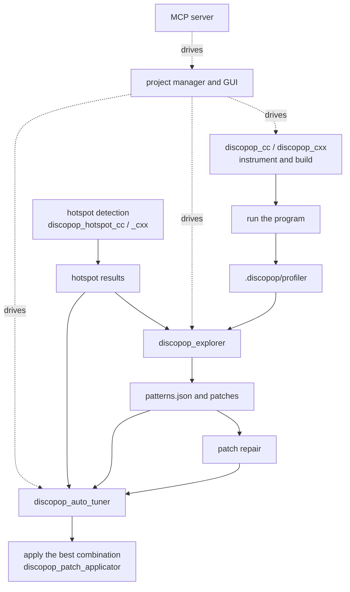

# Manual
The manual is the detailed reference of DiscoPoP. It is for users who want to go beyond the [graphical workflow](getting_started.md): install DiscoPoP in a non-standard way, run single tools on the command line, interpret the output files, or contribute to DiscoPoP.

## Components
DiscoPoP consists of seven Python packages, which `pip install discopop` installs together (the package `discopop` depends on all others).

| Folder | PyPI name | Console scripts | Purpose |
|---|---|---|---|
| `profiler` | `discopop-profiler` | `discopop_cc`, `discopop_cxx` | LLVM instrumentation pass and runtime library; compiler wrappers that instrument C and C++ code |
| `explorer` | `discopop-explorer` | `discopop_explorer` | Pattern detection on the profiling data |
| `library` | `discopop-library` | `discopop_gui`, `discopop_project_manager`, `discopop` (alias of `discopop_project_manager`), `discopop_patch_generator`, `discopop_patch_applicator`, `discopop_patch_repair`, `discopop_auto_tuner`, `discopop_optimizer`, `discopop_config_provider`, `discopop_sanity_checker`, `discopop_preprocessor`, `discopop_dependency_comparator`, `discopop_parallel_region_merger` | The project manager with the GUI, the patch tools, the autotuner and the helper tools |
| `hotspot_detection` | `discopop-hotspot-detection` | `discopop_hotspot_analyzer`, `discopop_hotspot_cc`, `discopop_hotspot_cxx` | Instrumentation that measures the hotness of code regions, and its analysis |
| `mcp_server` | `discopop-mcp-server` (module name `discopop_mcp_server`) | `discopop_mcp_server` | MCP server that lets AI assistants run DiscoPoP |
| `GUI` | `discopop-gui` | none | GUI components (graph visualizers); see below |
| `.` (root) | `discopop` | none | Meta package that depends on all of the above |

The `discopop_gui` command comes from `discopop-library`: the GUI is part of the project manager (`library/discopop_library/ProjectManager/gui`). The folder `GUI/` holds GUI components and declares no console script. The explorer depends on `discopop-library`, the library on `discopop-hotspot-detection`.

## Workflow

The [project manager](tools/Project_manager.md) and the [GUI](tools/GUI.md) run these steps for you; the [MCP server](tools/MCP_server.md) lets an AI assistant do the same.

## Guide to the sections
| Section | Content |
|---|---|
| [Setup](setup/setup.md) | [Installation](setup/discopop.md), [build options](setup/build_options.md), [environment variables](setup/environment_variables.md), [VS Code extension](setup/vscx.md) |
| [Examples](examples/examples.md) | [Command line walk-through](examples/walk_through.md), [project manager on the command line](examples/project_manager_cli.md), [GUI walk-through](examples/walk_through_gui.md), [VS Code extension walk-through](examples/walk_through_vscode.md) |
| [Tools](tools/tools.md) | Every tool with its options, from [compiler wrappers](tools/Instrumentation.md) to the [explorer](tools/Explorer.md), the patch tools, the [autotuner](tools/Autotuner.md) and the [MCP server](tools/MCP_server.md) |
| [Data](data/data.md) | The files DiscoPoP writes: [profiling output](data/Profiling_and_instrumentation_output.md), [explorer output](data/Explorer_output.md), [parallel patterns](data/Parallel_patterns/Patterns.md) |
| [How to contribute](How_to_contribute.md) | Development setup, code style, tests and the pull request process |
