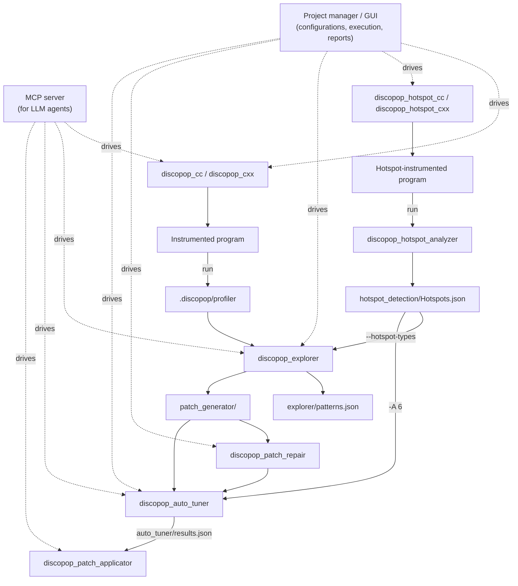

# Tools
DiscoPoP consists of several tools. Each tool reads the files of the previous one from the `.discopop` directory of your project and writes its own results back into it. The tools work on this directory and are run from inside it (`cd .discopop`), unless they take a path option such as `--path` or `--dot-dp-path`.

## Overview

1. You compile your program with the [compiler wrappers](Instrumentation.md) and run it. The instrumented program writes the profiling data to `.discopop/profiler`.
2. Optionally, you build the program with the [hotspot detection](Hotspot_detection.md) wrappers, run it with several inputs and analyze the runs. This creates `.discopop/hotspot_detection/Hotspots.json`.
3. The [Explorer](Explorer.md) detects parallel patterns and writes them to `.discopop/explorer/patterns.json`. It also creates the [patches](Patch_generator.md) in `.discopop/patch_generator/`.
4. Optionally, [patch repair](Patch_repair.md) lets an LLM agent fix patches that do not compile.
5. The [empirical autotuner](Autotuner.md) measures which suggestions pay off and writes the result to `.discopop/auto_tuner/results.json`.
6. The [patch applicator](Patch_applicator.md) applies the selected patches to your source code.

The [project manager](Project_manager.md) and the [GUI](GUI.md) store how your project is built and executed (*execution configurations*) and run these steps for you. The [MCP server](MCP_server.md) offers the same pipeline to LLM agents. All three use the same configurations below `.discopop/project`.

## Tools for users

| Command | Purpose | Page |
|---|---|---|
| `discopop_gui` | Graphical user interface for the whole workflow | [Graphical user interface](GUI.md) |
| `discopop_project_manager` (`discopop`) | Configurations, execution, measurements and reports on the command line | [Project manager](Project_manager.md) |
| `discopop_cc`, `discopop_cxx` | Compiler wrappers: instrument and profile your program | [Compiler wrappers](Instrumentation.md) |
| `discopop_hotspot_cc`, `discopop_hotspot_cxx`, `discopop_hotspot_analyzer` | Find the code regions that dominate the runtime | [Hotspot detection](Hotspot_detection.md) |
| `discopop_explorer` | Detect parallel patterns in the profiling data | [Explorer](Explorer.md) |
| `discopop_patch_generator` | Convert patterns into patch files | [Patch generator](Patch_generator.md) |
| `discopop_patch_applicator` | Apply, roll back and list patches | [Patch applicator](Patch_applicator.md) |
| `discopop_patch_repair` | Repair patches that do not compile, using an LLM agent | [Patch repair](Patch_repair.md) |
| `discopop_auto_tuner` | Measure and select the best combination of suggestions | [Empirical autotuner](Autotuner.md) |
| `discopop_mcp_server` | MCP server for LLM agents | [MCP server](MCP_server.md) |
| `discopop_optimizer` | Select suggestions using a performance model (experimental) | [Optimizer](Optimizer.md) |

## Helper tools
Helper tools are used by other tools or serve special purposes.

| Command | Purpose | Page |
|---|---|---|
| `discopop_config_provider` | Report the paths and the build configuration of the installation | [Helper tools](Helper_tools.md) |
| `discopop_sanity_checker` | Check suggestions with ThreadSanitizer | [Helper tools](Helper_tools.md) |
| `discopop_preprocessor` | Preprocess profiling data | [Helper tools](Helper_tools.md) |
| `discopop_dependency_comparator` | Compare two dependency files | [Helper tools](Helper_tools.md) |
| `discopop_parallel_region_merger` | Merge neighboring parallel regions | [Helper tools](Helper_tools.md) |
